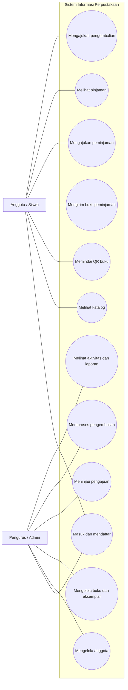
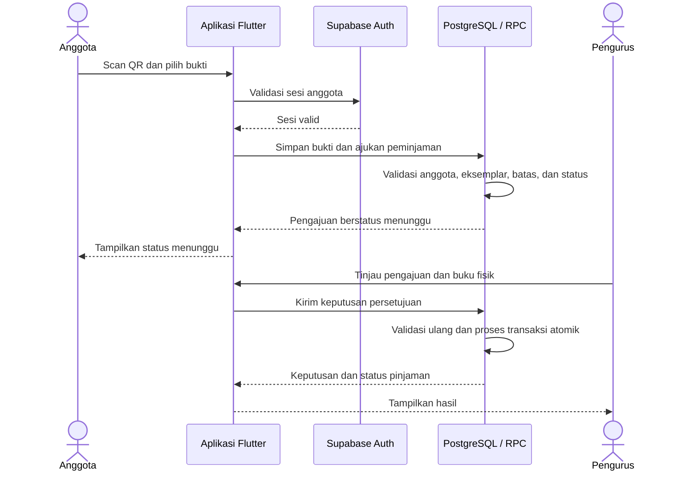
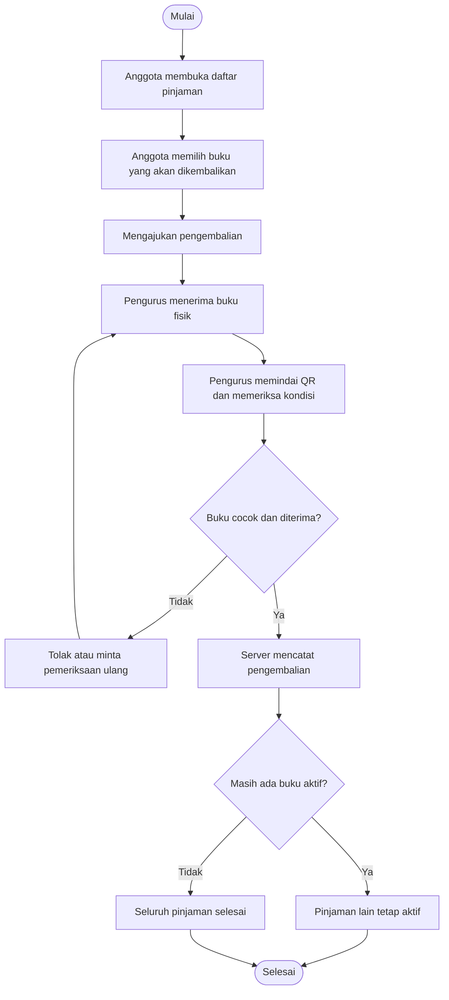
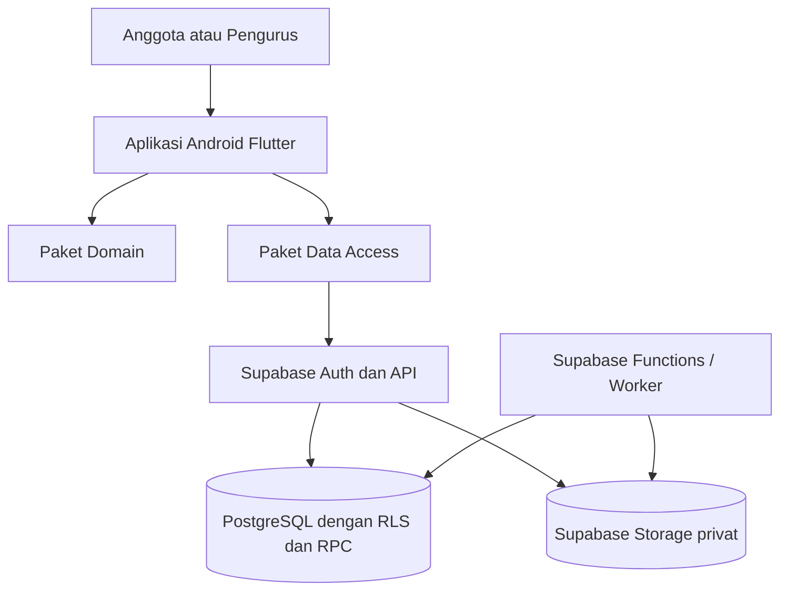

# Sistem Informasi Perpustakaan SMK Al-Munawwarah Cilacap

**Repository:** https://github.com/rezhazha41/apps-perpus

---

## 1. Deskripsi Proyek

Proyek ini mengembangkan sistem informasi perpustakaan berbasis Android untuk membantu pengurus dan anggota perpustakaan SMK Al-Munawwarah Cilacap mengelola katalog, eksemplar buku, peminjaman, dan pengembalian.

Anggota dapat mencari buku, memindai QR Code eksemplar, dan mengajukan peminjaman dengan bukti selfie atau kartu OSIS. Pengurus memeriksa pengajuan dan buku fisik sebelum menyetujui penyerahan. Stok berubah setelah persetujuan berhasil diproses oleh server.

Proyek ini juga menjadi objek analisis dan pengujian sistem, termasuk pengujian validasi, hak akses, integritas transaksi, pengembalian sebagian, serta kondisi kegagalan tertentu.

### Tujuan

- Mendigitalisasi pengelolaan katalog dan eksemplar buku.
- Mempermudah pencatatan peminjaman dan pengembalian.
- Mencegah peminjaman ganda pada eksemplar yang sama.
- Membatasi akses data sesuai peran anggota dan pengurus.
- Menyediakan pengujian yang dapat ditelusuri berdasarkan kebutuhan sistem.

### Pengguna Sistem

| Pengguna | Fungsi utama |
|---|---|
| Anggota/siswa | Melihat katalog, memindai QR, mengajukan peminjaman dan pengembalian, melihat status pinjaman |
| Pengurus/admin | Mengelola data anggota dan buku, meninjau pengajuan, memproses pengembalian, memantau aktivitas |

---

## 2. Desain Sistem dengan UML

### 2.1 Use Case

**Aktor anggota:** mendaftar, masuk, melihat katalog, memindai QR, mengirim bukti, mengajukan peminjaman, melihat pinjaman, dan mengajukan pengembalian.

**Aktor pengurus:** masuk, mengelola data anggota dan buku, membuat QR eksemplar, menyetujui atau menolak pengajuan, memeriksa pengembalian, serta melihat aktivitas dan laporan.



### 2.2 Sequence Diagram: Pengajuan dan Persetujuan Peminjaman



### 2.3 Activity Diagram: Pengembalian



---

## 3. Arsitektur Proyek

Aplikasi menggunakan arsitektur monorepo. Aplikasi Flutter menangani antarmuka dan interaksi pengguna, sedangkan Supabase menyediakan autentikasi, database PostgreSQL, penyimpanan berkas, serta fungsi backend.

Aturan akses penting diterapkan pada database dan backend. Perubahan transaksi peminjaman dan stok diproses melalui fungsi/RPC agar validasi dan perubahan data dapat dilakukan secara konsisten.



### Tanggung jawab komponen

| Komponen | Tanggung jawab |
|---|---|
| `apps/mobile` | Aplikasi Android, navigasi, layar anggota dan pengurus |
| `packages/domain` | Model dan aturan bisnis domain |
| `packages/data_access` | Akses data dan integrasi layanan |
| `packages/ui_kit` | Tema dan widget antarmuka bersama |
| `supabase/migrations` | Perubahan skema, aturan akses, dan fungsi transaksi database |
| `supabase/functions` | Fungsi backend dan proses terjadwal |
| `scripts` | Runner serta otomasi pengujian dan pengembangan |
| `docs` | PRD, arsitektur, status implementasi, dan bukti pengujian |

---

## 4. Teknologi yang Digunakan

| Bagian | Teknologi | Kegunaan |
|---|---|---|
| Frontend | Flutter dan Dart | Aplikasi Android anggota dan pengurus |
| Autentikasi | Supabase Auth | Login, pendaftaran, dan pengelolaan sesi |
| Backend/API | Supabase | API dan layanan backend |
| Database | PostgreSQL | Data siswa, buku, eksemplar, dan transaksi |
| Otorisasi | Row Level Security (RLS) | Pembatasan akses sesuai pengguna dan peran |
| Penyimpanan | Supabase Storage privat | Bukti peminjaman dan berkas terkait |
| Fungsi backend | Supabase Functions | Fungsi backend, termasuk rancangan pengingat |
| Pengujian | Flutter Test, Node.js Test, PGlite, PostgreSQL | Pengujian aplikasi, fungsi, dan aturan database |
| Build Android | Android SDK | Menjalankan dan membangun aplikasi Android |

---

## 5. Rencana dan Pengujian Sistem

Pengujian mencakup aturan bisnis, akses berdasarkan peran, konsistensi transaksi, dan perilaku aplikasi.

### Contoh kasus uji

| ID | Skenario | Hasil yang diharapkan |
|---|---|---|
| TC-01 | Anggota memindai QR eksemplar tersedia | Detail buku tampil dan stok belum berubah |
| TC-02 | Anggota mengajukan peminjaman dengan bukti valid | Pengajuan tercatat menunggu persetujuan |
| TC-03 | Pengurus menyetujui pengajuan yang valid | Pinjaman dan perubahan status eksemplar tercatat konsisten |
| TC-04 | Dua permintaan menyetujui eksemplar yang sama | Hanya satu transaksi berhasil |
| TC-05 | Anggota mencoba mengakses bukti milik anggota lain | Akses ditolak |
| TC-06 | Anggota mengembalikan sebagian buku | Hanya buku yang diterima pengurus yang ditutup |
| TC-07 | Anggota mencoba mengklaim token perangkat milik anggota lain | Permintaan ditolak dan pemilik token tidak berubah |
| TC-08 | Retry unggah arsip dengan isi berbeda | Retry gagal dan berkas arsip yang sudah ada tidak ditimpa |

### Hasil pengujian yang tercatat

Berdasarkan laporan pengujian lokal tanggal **21 Oktober 2026**:

- Flutter analyzer: **PASS**
- Flutter test: **44/44 PASS**
- Test worker notifikasi: **5/5 PASS**
- SQL/PGlite: **PASS**
- PostgreSQL dua koneksi untuk deduplikasi pengingat: **PASS**
- Pengujian Supabase aktif untuk dua migrasi M4: **belum dilakukan**
- Pengujian restore backup: **belum dilakukan**
- Pengujian UI Android melalui emulator/perangkat: **belum dilakukan**

Hasil pengujian lokal tidak otomatis membuktikan Storage API, RLS runtime, push notification, atau pemulihan backup pada server aktif.

---

## 6. Cara Menjalankan Proyek

Prasyarat: Flutter SDK dan Android SDK sudah terpasang. Konfigurasi Supabase harus disediakan melalui mekanisme konfigurasi lokal yang digunakan proyek.

```bash
flutter pub get
flutter analyze
flutter test
```

Untuk menjalankan aplikasi:

```bash
cd apps/mobile
flutter run
```

Nama file konfigurasi dan parameter Supabase mengikuti panduan proyek. Jangan menyimpan password database atau service-role key di aplikasi Flutter, repository, atau APK.

---

## 7. Batasan dan Status Pengerjaan

- Penerapan dua migrasi M4 pada Supabase aktif masih menunggu prasyarat backup dan persetujuan penerapan.
- Pengiriman push Firebase nyata belum dibuktikan.
- Restore backup belum diuji pada clone terisolasi.
- Pengujian UI Android melalui emulator/perangkat masih diperlukan.
- Riwayat data sebelum sistem digunakan tidak boleh diklaim sebagai histori lengkap.

Status fitur terkini dapat dilihat pada:

- `docs/PROJECT-STATUS.md`
- `docs/m4-m5-checkpoint.md`
- `docs/prd-traceability-m3-m5.md`
- `docs/m4-migration-review-2026-10-21.md`

---

## 8. Demonstrasi Proyek

Demo mencakup alur berikut:

1. Anggota masuk dan membuka katalog.
2. Anggota memindai QR serta mengajukan peminjaman dengan bukti.
3. Pengurus meninjau dan menyetujui atau menolak pengajuan.
4. Pengurus memproses pengembalian sebagian atau penuh.
5. Pengguna melihat status transaksi yang diperbarui.

**Catatan demo:** gunakan akun dan data sintetis. Jangan tampilkan secret, data siswa nyata, atau berkas bukti pribadi.

---

## 9. Pembagian Tugas Kelompok

| Anggota | NIM | Tanggung jawab |
|---|---|---|
| [Nama Ketua] | [NIM] | [Contoh: koordinasi dan integrasi proyek] |
| [Nama Anggota 1] | [NIM] | [Contoh: pengembangan aplikasi Flutter] |
| [Nama Anggota 2] | [NIM] | [Contoh: database dan pengujian] |

---

## 10. Referensi Proyek

- Product Requirements Document: dokumen PRD proyek
- Dokumentasi arsitektur: `docs/architecture.md`
- Status implementasi: `docs/PROJECT-STATUS.md`
- Matriks keterlacakan: `docs/prd-traceability-m3-m5.md`
- Repository GitHub: https://github.com/rezhazha41/apps-perpus
